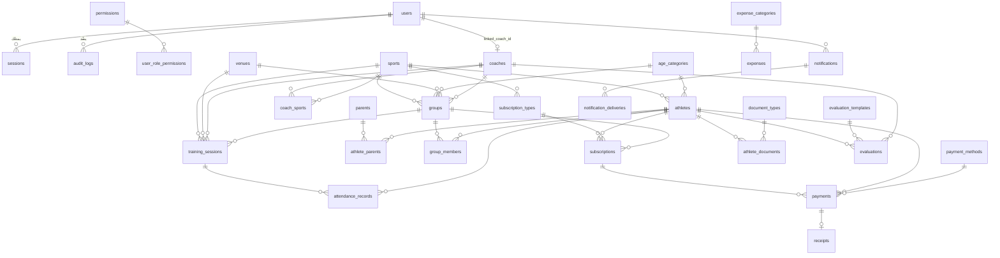

# مخطط قاعدة البيانات (DATABASE_SCHEMA)

> **NOT VERIFIED / لم يُتحقق منه:** هذا التوثيق مشتق مباشرة من `prisma/schema.prisma`
> و`prisma/raw-constraints.sql`، لكنه لم يُطبَّق على PostgreSQL حقيقي في بيئة التوثيق
> (لا يتوفر node/docker/postgres). للتحقق: `npx prisma migrate dev` ثم
> `psql "$DATABASE_URL" -f prisma/raw-constraints.sql` ثم `\d+ <table>`.

- **المزود:** PostgreSQL (إلزامي للإنتاج — SQLite يفتقد EXCLUDE والفهارس الجزئية).
- **المعرّفات:** UUID v4 (`@db.Uuid`) لكل الجداول.
- **الطوابع الزمنية:** `timestamptz(6)` (UTC)، والتواريخ التجارية `date`.
- **المال:** `BigInt` بأصغر وحدة (minor units) — انظر `docs/BUSINESS_RULES.md`.

## أعمدة مشتركة (نمط موحّد)

معظم الكيانات الأساسية تحمل: `id`, `created_at`, `updated_at`, `created_by`,
`updated_by` (UUIDs بلا FK — إسناد تدقيقي)، `deleted_at` (حذف ناعم)،
`version` (قفل تفاؤلي — عدم تطابق ⇒ 409 VERSION_CONFLICT).
لن تُكرر في كل جدول أدناه.

## مخطط ERD (الكيانات الرئيسية)

## الجداول

### الهوية والصلاحيات

| الجدول | الأعمدة الرئيسية | القيود/العلاقات |
|--------|------------------|-----------------|
| `users` | email (فريد), username (فريد), full_name, password_hash (Argon2id), role (enum: SUPER_ADMIN/ADMIN/RECEPTION/COACH/ACCOUNTANT/VIEWER), status, must_change_password, totp_enabled, totp_secret_hash, last_login_at, failed_login_count, locked_until, linked_coach_id | `deletedAt` + فهرس جزئي فريد على email؛ linked_coach_id فريد → coaches |
| `permissions` | code (فريد مثل `athletes.view`), module, description, is_system | مصدرها `catalog.ts` — تُبذر بـ `scripts/seed.ts` |
| `user_role_permissions` | role, permission_id, granted | `@@unique([role, permission_id])`؛ تخصيصات فوق المصفوفة الافتراضية |
| `sessions` | user_id, token_hash (فريد), ip_address, user_agent, expires_at (idle), absolute_exp, revoked_at | حذف تتالي مع المستخدم؛ فهارس على user_id وexpires_at |
| `password_reset_tokens` | user_id, token_hash, expires_at, used_at | لمرة واحدة |

### الإعدادات والمرجعيات

| الجدول | الأعمدة الرئيسية | ملاحظات |
|--------|------------------|---------|
| `settings` | key (فريد), value (text), value_type (string/number/boolean/json), group, description, updated_by | لا قيم صلبة في الكود — كل السلوك القابل للضبط هنا (انظر ASSUMPTIONS) |
| `sports` | name, name_en, color, is_active, sort_order | فهرس جزئي فريد `lower(name) WHERE deleted_at IS NULL` |
| `age_categories` | name, kind (NORMAL/SENIOR), min_age, max_age (null=أكابر), season_start_month (افتراضي 9), sort_order | CHECK: `max_age >= min_age` (SQL خام) |
| `venues` | name, type (HALL/FIELD/COURT/POOL/GYM/OTHER), capacity, status, location | فهرس جزئي فريد على lower(name) |
| `payment_methods` | name (فريد), is_active, sort_order | ديناميكية (ليست enum) |
| `expense_categories` | name (فريد), is_active, sort_order | |
| `document_types` | name (فريد), is_active, sort_order | |

### الرياضيون والأولياء

| الجدول | الأعمدة الرئيسية | القيود/العلاقات |
|--------|------------------|-----------------|
| `athletes` | registration_no (فريد جزئيًا), first/last_name, photo_url, gender, birth_date (date), phone, email, address, sport_id→sports, age_category_id→age_categories, registration_date, status (ACTIVE/INACTIVE/SUSPENDED/WITHDRAWN/BLOCKED), emergency_name/phone, **حقول حساسة:** medical_notes, blood_type, allergies, image_consent, scan_code_hash (فريد) + scan_code_version | فهرس جزئي فريد registration_no؛ فهرس GIN trgm على الاسم للبحث؛ الحقول الطبية خلف `athletes.view_sensitive` |
| `parents` | first/last_name, phone (فهرس جزئي), phone2, email, address, relationship | |
| `athlete_parents` | athlete_id, parent_id, relationship, is_primary, is_payer, is_emergency | `@@unique([athlete_id, parent_id])`؛ حذف تتالي |

### المجموعات والجدولة

| الجدول | الأعمدة الرئيسية | القيود/العلاقات |
|--------|------------------|-----------------|
| `coaches` | first/last_name, photo_url, phone, email, specialization, certificate, joined_at, is_active | → user عبر users.linked_coach_id |
| `coach_sports` | coach_id, sport_id | `@@unique([coach_id, sport_id])` |
| `groups` | name, code (فريد جزئيًا), sport_id (مطلوب), age_category_id, coach_id, venue_id, max_capacity, training_days (JSON), start_time/end_time (HH:mm), status | CHECK: `max_capacity >= 0`؛ **السعة تُفرض برمجيًا بقفل صف `SELECT ... FOR UPDATE`** (groups/service) |
| `group_members` | group_id, athlete_id, joined_at, left_at (null=نشط), leave_reason | `@@unique([group_id, athlete_id, left_at])` ⇒ عضوية نشطة واحدة |
| `training_sessions` | type (TRAINING/MATCH/TOURNAMENT/EXAM/ACTIVITY/MEETING), title, sport_id, group_id, coach_id, venue_id, session_date (date), start_time/end_time (timestamptz), status (SCHEDULED/CANCELLED/COMPLETED), series_id, is_exception | **3 قيود EXCLUDE gist** (مدرب/قاعة/مجموعة — انظر أدناه) |
| `attendance_records` | athlete_id, session_id, group_id, status (PRESENT/ABSENT/LATE/EXCUSED), method (MANUAL/BULK/QR/BARCODE/EXTERNAL), record_date, recorded_at, recorded_by, minutes_late, consumed_session, idempotency_key (فريد) | `@@unique([athlete_id, session_id])` ⇒ لا تكرار حضور |

### الاشتراكات والمال

| الجدول | الأعمدة الرئيسية | القيود/العلاقات |
|--------|------------------|-----------------|
| `subscription_types` | name, kind (MONTHLY/QUARTERLY/SEMI_ANNUAL/ANNUAL/SESSIONS/CUSTOM), sport_id, default_price **BigInt**, duration_days, sessions_total, allow_price_edit, is_active | |
| `subscriptions` | athlete_id, sport_id, group_id, subscription_type_id, start_date/end_date, price, discount_kind (FIXED/PERCENT), discount_value, discount_reason (إلزامي مع خصم), net_amount, paid_amount (مشتق), due_date, status (ACTIVE/EXPIRED/SUSPENDED/RENEWING/CANCELLED), sessions_total/used, suspend_*, cancel_reason, renewed_from_id | CHECK: `end_date >= start_date`؛ CHECK: قيم مالية ≥ 0؛ بلا FK لـ renewed_from_id (مرجع مرن) |
| `payments` | transaction_no (فريد تسلسلي لكل سنة مالية), athlete_id, subscription_id, amount **BigInt**, discount, net_amount, payment_method_id, payment_date, status (COMPLETED/VOIDED), void_reason/voided_at/voided_by, refunded_amount, employee_id, idempotency_key (فريد), receipt_id (فريد) | CHECK: `amount > 0`؛ **غير قابل للتعديل** — التصحيح بالإلغاء/الاسترداد فقط |
| `receipts` | receipt_no (فريد), fiscal_year, sequence, payment_id, status, reprint_count, last_reprint_at, template (A4/80mm) | `@@unique([fiscal_year, sequence])` ⇒ تسلسل بلا فجوات بقفل استشاري |
| `expenses` | amount **BigInt**, category_id, expense_date, description, beneficiary, employee_id, status (ACTIVE/VOIDED), void_reason, attachments (JSON) | CHECK: `amount > 0` |
| `cash_transactions` | type (OPENING_BALANCE/INCOME/EXPENSE/ADJUSTMENT/REVERSAL), amount **BigInt**, balance_after, reference_type/reference_id, reason, tx_date | **Append-Only** — لا تعديل/حذف برمجيًا |
| `cash_closings` | closing_date (فريد), expected_amount, counted_amount, difference, reason, closed_by/at | إقفال يومي واحد لكل تاريخ |

### التقييمات والوثائق والإشعارات

| الجدول | الأعمدة الرئيسية | ملاحظات |
|--------|------------------|---------|
| `evaluation_templates` | name, sport_id, criteria (JSON), is_active | |
| `evaluations` | athlete_id, template_id, coach_id, evaluation_date, scores (JSON), notes | فهرس (athlete_id, evaluation_date) للسلاسل الزمنية |
| `athlete_documents` | athlete_id, document_type_id, storage_key (خارج المجلد العام), original_name, mime_type, size_bytes, expiry_date, status | فحص Magic Bytes عند الرفع (shared/storage) |
| `notifications` | type (11 نوعًا), user_id أو role_target, title, body, entity_type/entity_id, dedupe_key (فريد), is_read/read_at | idempotent عبر dedupe_key |
| `notification_deliveries` | notification_id, channel (IN_APP/EMAIL/SMS/WHATSAPP), recipient, status, attempts, last_error | القنوات الخارجية معطلة افتراضيًا |

### التشغيل والتدقيق

| الجدول | الأعمدة الرئيسية | ملاحظات |
|--------|------------------|---------|
| `import_jobs` | entity_type, file_name, storage_key, status (UPLOADED→…→COMPLETED/FAILED), column_mapping (JSON), total/success/failed_rows, errors_file_key, mode | |
| `audit_logs` | user_id, action (18 فعلًا), entity_type/entity_id, request_id, ip_address, user_agent, before/after (JSON), metadata | **Append-Only**: يُسحب UPDATE/DELETE من دور التطبيق بـ REVOKE |
| `job_runs` | job_name, status, started_at/finished_at, items_processed, error, lock_key (فريد) | أقفال المهام المجدولة |
| `backup_records` | file_name, storage_key, size_bytes **BigInt**, kind (manual/daily/weekly/monthly), checksum (SHA-256), restored_at | |

## قيود SQL الخام (`prisma/raw-constraints.sql`)

لا يعبر Prisma عن هذه القيود — تُطبَّق بعد الهجرة (أو تدمج في نهايتها):

1. **Extensions**: `btree_gist` (لتعارض الحصص) و`pg_trgm` (للبحث المتسامح).
2. **فهارس فريدة جزئية** `WHERE deleted_at IS NULL`: users.email,
   sports.lower(name), venues.lower(name), groups.code, athletes.registration_no —
   وفهرس parents.phone (غير فريد) — حتى لا يمنع الحذف الناعم إعادة استخدام القيم.
3. **فهرس بحث GIN**: `athletes (first_name || ' ' || last_name) gin_trgm_ops`.
4. **EXCLUDE USING gist على training_sessions** — منع تداخل النطاق
   `[start_time, end_time)` لكل من (coach_id), (venue_id), (group_id)،
   مستثنيًا الملغى/المحذوف (`WHERE ... status <> 'CANCELLED' AND deleted_at IS NULL`).
   هذا هو ضمان "لا تعارض" على مستوى القاعدة حتى تحت التزامن.
5. **CHECK constraints**: subscriptions (end_date ≥ start_date؛ price/net/paid/sessions_used ≥ 0)،
   payments.amount > 0، expenses.amount > 0، groups.max_capacity ≥ 0،
   age_categories (max_age ≥ min_age أو null).
6. **Audit append-only**: `REVOKE UPDATE, DELETE ON audit_logs FROM <app_role>;`
   — يدويًا، بدور قاعدة بيانات مختلف عن دور التطبيق (انظر SECURITY/DEPLOYMENT).
7. **Trigger اختياري** `set_updated_at()` (Prisma يدير updated_at أيضًا).

## Enums (ملخص)

UserRole, UserStatus, AthleteStatus, Gender, GroupStatus, VenueType, VenueStatus,
SessionType, SessionStatus, AttendanceStatus, AttendanceMethod, SubscriptionStatus,
SubscriptionTypeKind, DiscountKind, PaymentStatus, ExpenseStatus, CashTransactionType,
DocumentStatus, NotificationType, NotificationChannel, DeliveryStatus, AuditAction,
ImportStatus, JobStatus, AgeCategoryKind — قيمها موثقة في `prisma/schema.prisma`.
